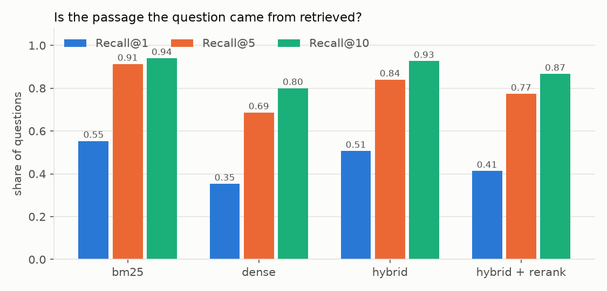

# paper-rag

Ask questions about a set of research papers and get short answers that cite the exact passage and page they came from. Under the hood it's a retrieval-augmented generation (RAG) pipeline: hybrid search (BM25 + embeddings), a cross-encoder reranker, and an LLM told to answer only from what it was given.

The part I cared about most is **measuring** it. "The answers look good" doesn't tell you much, so the project ships its own evaluation: a generated test set where every question has a known source passage, retrieval metrics for each retriever, and LLM-judged correctness and faithfulness, compared against the same LLM answering without any sources.

<!-- EXAMPLE: real output from the first run goes here -->

## Results

Corpus: 30 RAG and retrieval papers from arXiv, 1,246 chunks. Test set: 150 generated questions (`results/eval_set.jsonl`). LLM: Claude Haiku 5.5.

### Retrieval

| retriever | Recall@1 | Recall@5 | Recall@10 | MRR@10 | right paper in top 5 | median latency |
|---|---:|---:|---:|---:|---:|---:|
| **BM25** | **0.55** | **0.91** | **0.94** | **0.70** | **0.99** | **3 ms** |
| dense (bge-small) | 0.35 | 0.69 | 0.80 | 0.50 | 0.94 | 73 ms |
| hybrid (RRF) | 0.51 | 0.84 | 0.93 | 0.65 | 0.97 | 105 ms |
| hybrid + rerank | 0.41 | 0.77 | 0.87 | 0.57 | 0.99 | 2.8 s |



This is not the result I expected when I designed the pipeline, and I think it's the most useful thing the evaluation showed.

**Plain BM25 wins.** Even with the 5-gram copy filter, a question generated from a passage still names what the passage is about: "C-Pack", "LLaMA-13B", "TREC-COVID", "Natural Questions". In papers, those names are the most specific thing a query can contain, and exact matching is what BM25 is built for. The small embedding model (384 dimensions) maps "DPR vs BM25 throughput on Wikipedia" close to a dozen chunks that all talk about DPR and BM25, without the detail that separates them. Fusion helps dense a lot but can only pull BM25 down here, because dense mostly adds near-misses.

**The reranker makes things worse and is 25x slower.** `ms-marco-MiniLM-L-6-v2` was trained on short web queries over web passages. It still finds the right *paper* 99% of the time, but within the paper it often prefers a neighbouring chunk. With 40-word overlaps, that neighbour frequently holds the same fact, so strict recall exaggerates the damage. It's still a real drop and not worth 2.8 seconds per query on a CPU.

**What I'd change next:** default to BM25 + dense with BM25 weighted higher in the fusion (or BM25 alone for this kind of corpus), drop the MiniLM reranker or replace it with one trained on scientific text, and build a set of real, hand-written questions. Generated questions favour keyword search, so these numbers probably overstate how much BM25 wins in real use.


<!-- ANSWERS -->

## How it works

```
papers.txt ─► arXiv API ─► PDF ─► text per page ─► ~220-word chunks (sentence boundaries, 40-word overlap)
                                                         │
                                         ┌───────────────┴───────────────┐
                                         ▼                               ▼
                                   BM25 (keywords)              bge-small embeddings
                                         └──── reciprocal rank fusion ───┘
                                                         ▼
                                       top 30 ─► cross-encoder rerank ─► top 5
                                                         ▼
                                  LLM: answer only from sources, cite [n], or say it can't
```

A few decisions worth explaining:

- **Hybrid retrieval.** Embeddings are good at paraphrases ("negative examples" ≈ "negatives"), but they're weak on exact names, numbers and acronyms (e.g. "BEIR", "RETRO", "k = 60"). BM25 is the opposite. The two rankings are merged with reciprocal rank fusion, which only uses ranks, so there's no need to calibrate BM25 scores against cosine similarities. (On this corpus BM25 alone turned out better; see the results.)
- **Reranking.** The first stage compares a precomputed vector per chunk with the query vector, which is fast but shallow. The cross-encoder reads the question and each candidate chunk *together*. It's too slow to run over the whole corpus, so it only reorders the top 30. That was the theory; in the evaluation this particular reranker hurt (see the results), and `--no-rerank` turns it off.
- **Chunking.** Chunks follow sentence boundaries and overlap, so a definition that crosses a chunk boundary still appears whole somewhere. The reference list is cut off before chunking because it matches almost every query and answers none.
- **Citations are checked.** The model is told to cite `[n]` for every claim. The pipeline records which sources were cited and flags numbers that don't exist.
- **No vendor SDKs.** The LLM clients are about 30 lines of plain HTTP. They work with Anthropic, OpenAI, or any OpenAI-compatible server (Ollama, vLLM, LM Studio).
- **Cost cap.** Every API call is metered from the token counts the API returns. The run stops before any call once the cap is reached (default $1, `RAG_MAX_COST_USD`). The evaluation prints an upper-bound estimate first and refuses to start if it's above the cap.

## How the evaluation works

1. **Test set.** Sample about 150 chunks, round-robin across papers. For each one, the LLM writes a question the chunk answers plus a one-sentence reference answer. Questions that copy five or more consecutive words from the chunk are thrown away, because otherwise BM25 would win by string matching. The chunk is the gold passage.
2. **Retrieval.** For each retriever (BM25, dense, hybrid, hybrid + rerank): Recall@1/5/10 of the gold chunk, MRR@10, and the share of questions where the right *paper* is in the top 5.
3. **Answers.** On a subset of questions, the same LLM answers twice: with retrieved sources (RAG) and without (closed book). A judge model scores each answer 1-5 against the reference and checks whether the RAG answer is supported by its sources.

Known limitations, so the numbers are read correctly:
- The questions are generated from single chunks, so they are more local and more answerable than real user questions. Recall here is an upper bound on what real use would show.
- Strict recall counts only the exact gold chunk. Overlapping neighbours with the same information count as misses, which is why the paper-level metric is also reported.
- Using the same model as generator and judge can flatter its own answers. `JUDGE_MODEL` lets you use a different judge.

## Running it

```bash
git clone https://github.com/antony0167/paper-rag && cd paper-rag
python -m venv .venv && source .venv/bin/activate      # Windows: .venv\Scripts\activate
pip install -e ".[dev]"

cp .env.example .env          # then set LLM_PROVIDER and the API key
paper-rag ingest              # ~30 papers from papers.txt (downloads ~60 MB of PDFs)
paper-rag ask "How does Self-RAG decide when to retrieve?"
paper-rag eval                # writes results/
paper-rag serve               # HTTP API on http://127.0.0.1:8000/docs
```

Other corpora: `paper-rag ingest --query "graph neural networks" --max 40`.

With Docker (local model through Ollama, no API key):

```bash
docker compose up -d
docker compose exec ollama ollama pull qwen2.5:7b
docker compose run --rm api paper-rag ingest
curl -s localhost:8000/ask -H 'content-type: application/json' -d '{"question": "What is HyDE?"}'
```

## Project layout

```
src/paper_rag/
  papers.py     arXiv metadata + PDF download, PDF -> text
  chunking.py   sentence-aware overlapping chunks with page numbers
  embed.py      sentence-transformers embeddings (+ a hashing embedder for tests)
  index.py      BM25, dense and hybrid (RRF) search; save/load
  pipeline.py   reranking, prompt, citations
  llm.py        Anthropic / OpenAI-compatible clients, token metering, cost cap
  evaluate.py   test-set generation, retrieval metrics, LLM-judged answers
  report.py     results/summary.md and the chart
  api.py, cli.py
tests/          unit tests + an end-to-end CLI run with stand-in models (no network needed)
```
